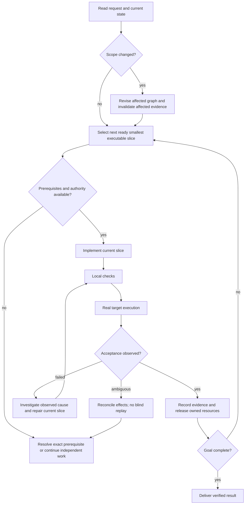

# Operating algorithm

## When to load this workflow

Load this workflow when choosing, revising, or recovering the next executable
slice of an authorized software task. Use the current request, existing
algorithm, scoped evidence, and file ownership to select the next slice and its
[real-test contract](#real-test-contract). If a consequential product decision
still blocks selection after reviewing the existing records, requirements,
and code, follow the [clarification gate](#requirement-40-clarification-gate).

## Algorithm format
Use the project's existing format, preferably a short Markdown table plus a Mermaid flowchart. A simple task needs a simple diagram. Required facts (not new paperwork): goal and acceptance, current revision, owner, ordered nodes and dependencies, next slice, observed state, real evidence link, blocker and next action. Detail each executable node with input, preconditions, effect, target, expected observation, recovery and stop conditions. Decisions must have named branches; loops must have an attempt/time budget and a changed-hypothesis requirement. An input receipt is not an executed effect.

## Dynamic revisions
On a new user request: capture the request source/time, update goal/non-goals and affected nodes, preserve unchanged verified nodes, invalidate evidence for changed code, contract, dependency or target, then choose the next ready slice. Do not silently retain “done” after its acceptance criterion changes. A new owner reads only the compact current handoff and needed linked evidence. Preserve obsolete decisions as short history, not executable backlog.

Before starting or resuming a dependent slice, even without a new request, check at `E` that each prerequisite's prior real acceptance still applies to its current code, dependencies, target environment, and requirements. Reuse matching evidence without repeating its checks. Reassess only affected evidence and repeat the necessary authorized real checks. Hold dependent work until each prerequisite has current passing evidence. Report any required context or target information that is unavailable. Continue eligible independent work within the existing STOP, refusal, ownership, and effect-reconciliation boundaries.

## Requirement 40: clarification gate

When the requested product scope is too ambiguous to begin coding, first inspect the project's existing records, requirements and relevant code for an answer. If a consequential ambiguity still prevents choosing the next executable step, ask short, concrete questions that identify exactly what is missing. Do not invent the intended product behavior. Do not block development for routine technical decisions or reasonable implementation choices: decide those within the existing authorization and continue independent work that is already clear. Record the clarified acceptance criteria in the existing project record rather than creating a second backlog.

For example, an unspecified required output format that cannot be recovered from the records may need a question; an internal helper name or equivalent reversible implementation choice normally does not. Ask only about the unresolved product decision, not whether to continue already-authorized work. Clarification never expands permissions or overrides a denial.

## Real-test contract
Before coding, specify the supported product entry point, actual environment/device/service, expected user-visible or machine-observable result, safe test data, and cleanup. Identify which assertions local tests cover and which require real execution. An integration test against a fake server remains synthetic. For a library, real use through its public API in its intended runtime can be the target; desktop clicks are not universally required. For this skill, actual helper execution and independent behavioral evaluations are distinct evidence categories, not proof of performance in every future project.

If access is missing: attempt only already-authorized supported preparation, distinguish an unmet prerequisite from a denial, and give the precise missing action. Never treat UNKNOWN as zero, safe, successful, forbidden, or permission. Use the user's actual budget/stop rules, not hardcoded account thresholds. A real service refusal stops the affected operation.

## Optional machine-readable plan
Use only if helpful; do not create a second ledger beside an existing canonical state. `validate` reads this optional JSON without changing it:

- `revision`: non-empty string; `goal`: non-empty string.
- `nodes`: array, each `id`, `owner`, `depends_on` (IDs), `status` (`planned`, `active`, `blocked`, `verified`), `acceptance`, `target`, `revision`.
- A verified node needs `evidence`: `kind: real`, `result: pass`, matching `revision`, matching `target`, non-empty `reference`, ISO `observed_at`.
- Active/verified nodes require verified dependencies. At most one active critical-path node. All nodes here describe the serial critical path, not independently parallel helpers.
- `next`: ID of the active or planned ready node; null only if all verified or every unfinished node is blocked/dependent on blocked work.

The helper rejects malformed graphs, cycles, incomplete/stale evidence metadata and advancing past an unverified dependency. It cannot tell whether evidence is truthful or sufficiently fresh for a changed external environment. The owner must inspect the referenced artifact and current conditions.

## Source-derived control-flow drafts

The bundled `scripts/flow_schema_42d8e671.py` reads the actual selected Markdown source and recognizes a deliberately narrow Mermaid profile: exactly one top-level, exact triple-backtick `mermaid` block containing `flowchart TD`, one plain `-->` edge per line, explicit rectangular action or brace decision labels, and optional `|label|` on decision edges. Node identifiers start with an ASCII letter and then contain at most 63 ASCII letters, digits or underscores. Every referenced node must be explicitly defined once; actions have at most one unlabeled outgoing edge, and decisions need at least two distinct labeled outgoing edges. It rejects undefined/redefined nodes, duplicated edges, unsupported quoted or escaped labels, nested/container diagrams, HTML block context, ambiguous or unclosed fences, extra Mermaid blocks and size limits instead of skipping them. Other well-formed fenced examples are not interpreted as diagrams. The input bound is 4,194,304 characters, with at most 256 nodes, 1,024 edges, 2,048 characters per diagram line and 512 characters per label.

This profile fits the operating flowchart above. It does not interpret heterogeneous project Markdown tables, arbitrary prose, every Mermaid shape or multiple selected diagrams. Parsing yields source/document and diagram digests, nodes, control edges, entry and terminal nodes, and cyclic strongly connected components. A terminal is not automatically success; a decision's listed labels do not establish every possible runtime outcome; a cyclic component does not provide a retry budget. Never replace alternative incoming control edges with unconditional AND dependencies.

`scripts/flow_cards_f930b1a6.py` derives one **unresolved candidate** from each actual parsed node and preserves every incoming and outgoing transition. Its audit reparses the supplied current source and rejects missing, extra or changed node cards or transitions. The `preview` operation checks a proposed sequence of explicit source edges and reports unvisited nodes/edges and repeated nodes; it does not observe a branch, grant a retry budget or execute a route. The `bind` operation first audits all source drafts, then reuses the existing task-card helper to attach explicit slice metadata to one action node. Decision binding is not supported. Other nodes remain unbound; source-node semantic coverage, incoming branch conditions, host authorization and real acceptance remain unverified.

The CLI `python -I -S -B scripts/flow_cards_f930b1a6.py drafts` reads the selected Markdown as UTF-8 bytes from stdin. `audit`, `preview` and `bind` read strict UTF-8 JSON with the named arguments used by their documented Python APIs. Each CLI request is limited to 4,194,304 bytes, and a proposed route to 1,024 transitions. The `drafts` command rejects a result if the original source and its bundle cannot subsequently fit in a compact UTF-8 JSON audit request with unescaped Unicode under that same limit. Extra whitespace, optional Unicode escapes or additional preview and binding data can still exceed the limit. These operations produce data only: no source action, target test or shell command is run. Do not dispatch a candidate or a bound slice merely because structural coverage passed; first resolve its actual scope, activation conditions, ownership, STOP/denial state and real target acceptance.

## Source-complete task cards

Select the authoritative **current** source graph before making cards. Decompose each source node into explicit, smallest independently executable slices; preserve an intentional one-to-many relationship rather than silently dropping a node. Specify every slice's inputs, outputs, file owners, prerequisites, acceptance and actual target-test contract. Compare the entire selected source against the cards, including IDs, content, dependencies and the selected source revision. An incomplete, extra, altered, cyclic or conflicting plan is not released for execution. Historical Markdown tables or a self-declared list of cards do not establish the source scope. When the canonical algorithm is prose or a mixed historical record, the owner must explicitly select and faithfully structure the current graph and compare that selection with its authoritative source.

The optional `scripts/task_cards_a61e2c97.py` helper accepts a structured source with exactly `revision` and nonempty `nodes`. Each node has `id`, node-level `depends_on`, and nonempty `slices`. Each slice has `id`, `owner`, `contract`, `inputs`, nonempty `outputs`, `read_files`, `file_owners`, slice-level `depends_on`, `acceptance`, and `real_test` with nonempty `target`, `action`, and `expected`. Inputs and outputs are descriptions; `read_files` and the keys of `file_owners` are project-relative file paths. An explicitly empty input list or file-owner mapping is allowed for an input-free or file-write-free slice. Every declared file owner must equal the slice owner; delegated writes are not modeled by this helper and require a separately supported, authorized handoff. The owner must declare every intended read and write; the helper cannot infer omitted effects or prove a slice is semantically atomic.

`generate_cards(source)` returns one card per explicit slice, an expanded dependency graph, the source revision and a deterministic digest of its canonical contents. Each node-level prerequisite orders all slices of the dependent node after all slices of the prerequisite node. `validate_cards(source, bundle)` recomputes from the selected source and rejects missing, extra, duplicate or altered cards, stale source revisions/digests, missing dependencies, cycles and unordered declared file conflicts. File comparisons use Unicode NFC and case folding; an explicit dependency may order a shared read/write or write/write resource. File-owner contradictions and incompatible parent/child file paths are rejected. These checks are conservative lexical comparisons, not proof against every filesystem alias or an uncooperative writer.

The CLI `python -I -S -B scripts/task_cards_a61e2c97.py generate` reads a strict UTF-8 source JSON object from stdin and emits a bundle. `validate` reads `{"source": SOURCE, "bundle": BUNDLE}` and emits a coverage result. Duplicate JSON object keys are rejected at every level. Callers of the in-process API must themselves use a strict parser before constructing a mapping: duplicate keys cannot be recovered from a mapping already parsed permissively. `generate` requires the source and returned bundle to fit a compact UTF-8 JSON `validate` request within the CLI's 4,194,304 decoded-character limit. Extra whitespace and escaping count toward that limit. The API and CLI allow up to 512 source nodes, 1,024 slices, an upper bound of 32,768 expanded dependency edges, and 8,192 declared file references. Each list or file-owner mapping allows at most 4,096 entries, and a declared path at most 4,096 characters. Exceeding a limit fails closed.

Invalid input returns exit 2 and no ready work. The helper performs no task, target test or shell command. Before any later dispatch, re-read the authoritative current source, verify authorization and the current STOP/denial state, and separately perform the owner's real target acceptance test. A generated card or `valid` result is not evidence that code ran. The older `evaluate(root, plan, ...)` accepts only its supplied nodes; it cannot discover missing nodes from an independent source graph and must not be mistaken for the coverage check.

## Optional cooperative continuity helpers

`scripts/claim_guard_8d31f72a.py` exposes `claim(project, slice_id, files)` as a context manager. A participant holds nonblocking OS locks for the slice and its project-relative file paths for as long as its process holds the handles. All writers must participate with the same identities; it cannot restrain another program. A conflict raises `ClaimBusyError`, while other access failures propagate. Fixed persistent guard stripes keep coordination storage bounded; collisions can conservatively report busy. The helper never deletes guards or treats a PID, timeout or age as proof of release. A crash releases its OS handles but the new owner must reconcile partial product effects before resuming. An unknown or incompletely initialized guard is preserved for inspection. Path checks reduce accidental escapes but do not defeat hostile concurrent filesystem replacement.

`scripts/continuity_plan_64e9b1c2.py` exposes the read-only `evaluate(root, plan, previous, observed, stopped=..., denied=...)` API. Each node describes its id, owner, file owners, contract, input and output paths, dependencies, target and target SHA-256 expectation. Every declared writable file owner must equal the node owner; a mismatch is rejected before any file reads. This tightens earlier behavior that allowed one node to claim another owner's file. An ordered shared claim within one plan still needs the same owner; a change of owner requires the host to reconcile the previous work and explicitly establish a new plan and handoff rather than infer delegation. The helper checks a dependency graph, rejects unordered shared file claims, reads actual project files, calculates deterministic fingerprints, reuses matching file observations and lists ready nonconflicting nodes. A changed file, contract or dependency invalidates affected file observations. A STOP halts the evaluation; explicitly denied node IDs and their dependents are blocked while independent nodes remain eligible. The caller must carry forward the actual scope of a refusal and must not retry or re-express it under another identity.

These are file-state observations, not evidence that code executed, that an expected hash is correct, or that submitted prior evidence or authorizations are authentic. The legacy `ready`, `continuation_permitted` and `dependencies_verified` fields describe file-observation planning and can be true before actual product acceptance. Every returned result explicitly sets `product_acceptance_verified` and `execution_authorized` to false because this helper establishes neither. A target file match cannot by itself mark product behavior complete or authorize the next product-dependent slice. The owner performs and records the actual target acceptance test separately. The helpers do not schedule agents, enforce ownership for nonparticipants, resume a turn, or replace the canonical project record.
